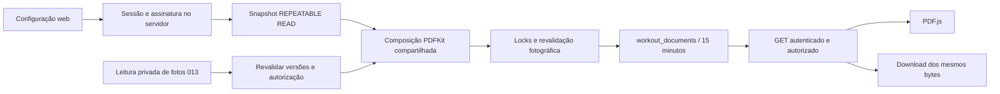

# ADR 014 — Relatórios físicos e shell profissional

A FormFisik é empresa independente fundada por Brandon Louis. Estado: implementado e validado localmente; sem deploy/migração no banco existente.

## Auditoria anterior à implementação

011/011.5: PDFKit, DejaVu local, identidade em professional_presentations e logo sanitizado, PDF.js, artefato bytea privado de 15 minutos/limite de três, cleanup e cabeçalhos já existem. O renderer workoutPdf contém componentes locais acoplados a divisões/séries e não aceita avaliações. Extrair somente infraestrutura de composição aplicável (fontes, texto, quebra, cabeçalhos/rodapés, limites) e reutilizar a mesma tabela/política de artefatos, apresentação, visualizador e fronteira de autorização; não criar segundo cadastro/armazenamento/viewer.

012: valores atuais + versão e auditoria, sem snapshots antigos de medidas. Reutilizar comparação/difference exatas e extrair geometria dos pontos SVG para web/PDF vetorial. Relatório representa snapshot coerente capturado agora, nunca reconstrução de valores anteriores. Não existe objetivo próprio de acompanhamento no cadastro/avaliações: informar ausência, não inferir objetivo da prescrição nem usar notas administrativas.

013: imagens privadas, posições, referências opacas, autorização específica de armazenamento, readPhoto com revalidação após I/O e adaptador R2 injetável exclusivamente nos testes. Reutilizar leitura e validação de autorização/menor; acrescentar declaração verificável para exportação compartilhável vinculada às imagens e configuração exatas. Armazenamento autorizado não concede essa nova finalidade.

Shell atual: grid com min-height e sidebar sticky; documento inteiro rola. Sidebar combina marca/nav/logout numa área única. Corrigir a raiz compartilhada para altura de viewport, coluna principal flex/min-height zero e main com único scroll; header fora do scroll. Marca/logout não rolam; somente navegação extensa possui overflow. Menu dialog existente e avisos de alterações não salvas mantidos.

## Estratégia

Migration aditiva estende workout_documents para tipos workout/physical_report, preservando colunas/FKs de treinos para os documentos antigos, mesma expiração/cleanup/capacidade. Referências fotográficas e consentimento de exportação acompanham o artefato temporário; exclusão o remove em cascata. Documentos com fotos têm autorização revalidada em cada leitura e são negados após remoção/substituição/revogação das fotos. Arquivo baixado externamente não pode ser recolhido.

Captura de aluno, apresentação e avaliações em transação REPEATABLE READ; manifest privado registra opções, dados selecionados, versões e instante. Fotos são lidas pela abstração existente e rechecadas sob locks antes de persistir o PDF. Edição concorrente não mistura valores; revogação invalida geração/leitura. Sem fotos, não há dependência de R2. Limites explícitos rejeitam excesso sem truncar.

Estado de filtros/seleções e posições de navegação ficam apenas na memória do shell da sessão React, com capacidade limitada; nunca Web Storage. Rotas novas iniciam no topo; retorno/back a listas recupera contexto. Paginação/filtro explícitos reposicionam o conteúdo, painéis mantidos preservam rascunho e dialogs bloqueiam a rolagem de fundo.

## Fluxo de documentos

Uma declaração específica de exportação acompanha as referências das fotografias. Triggers excluem artefatos relacionados à revogação/substituição; não há tentativa de recolher cópias externas. A consulta de fotos sem R2 ainda verifica o vínculo proprietário do aluno, antes de responder disponibilidade.

A revisão final identificou que o texto acessível absoluto do PDF podia usar o documento como containing block, ampliando sua rolagem apesar do overflow do shell. Raiz, main e viewer agora estabelecem referência relativa; o texto continua disponível para leitores de tela dentro da área de conteúdo. A regressão tenta rolar explicitamente a janela após renderização, além de medir sidebar/header.
